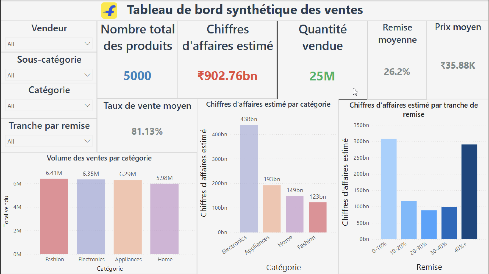
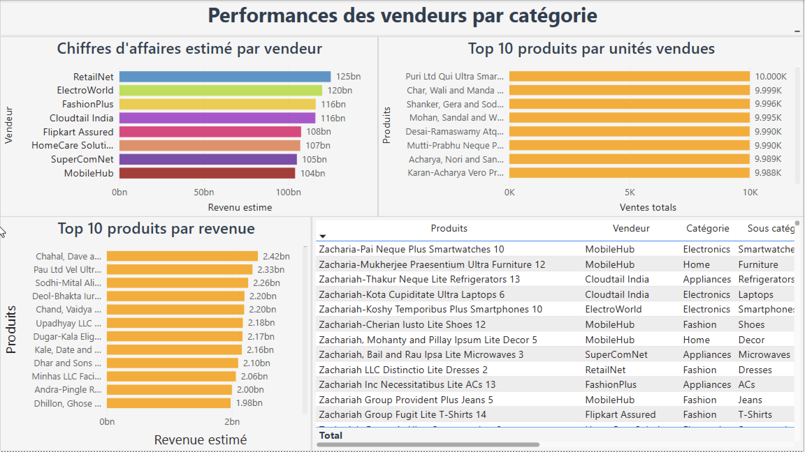
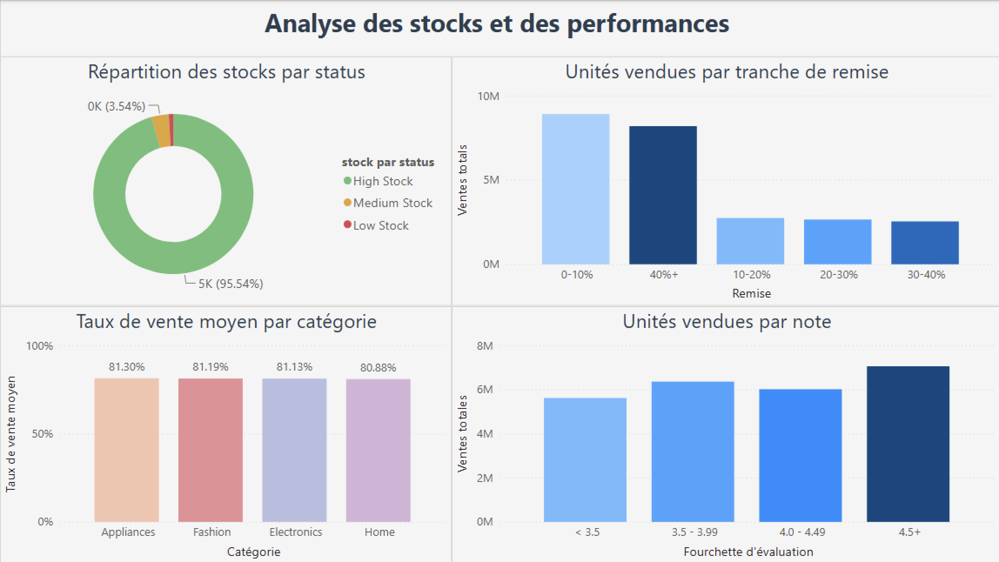

# 8. Power BI Dashboard

Le dashboard Power BI synthétise les résultats de l'analyse et permet d'explorer les performances commerciales selon plusieurs dimensions : **ventes, catégories, vendeurs, remises, produits, stocks et satisfaction client**.

Les trois pages sont complémentaires :

1. **Vue d'ensemble des ventes**
2. **Performance des vendeurs et des produits**
3. **Analyse des stocks et des performances**

---

## 8.1 Page 1 — Tableau de bord synthétique des ventes

### Objectif

Cette première page fournit une **vue globale de la performance commerciale** et permet d'identifier rapidement les principaux indicateurs de l'activité.

Les principaux KPI affichés sont :

* **5 000 produits**
* **₹902,76 Md de CA estimé**
* **25 M d'unités vendues**
* **26,2 % de remise moyenne**
* **₹35,88 K de prix moyen**
* **81,13 % de taux de vente moyen**

### Performance par catégorie

Le graphique du CA estimé par catégorie confirme la forte contribution de la catégorie **Electronics**, avec environ **₹438 Md**.

Elle est suivie par :

* **Appliances :** ₹193 Md
* **Home :** ₹149 Md
* **Fashion :** ₹123 Md

À l'inverse, le graphique du volume des ventes montre que **Fashion** possède le plus grand volume avec **6,41 M d'unités vendues**, devant Electronics avec **6,35 M**.

Cette comparaison met en évidence un point important : **la catégorie qui vend le plus d'unités n'est pas nécessairement celle qui génère le plus de valeur**. Le niveau de prix moyen joue donc un rôle important dans la valeur totale générée.

### Impact des remises

La répartition du CA estimé par tranche de remise montre que les ventes ne sont pas concentrées sur une seule tranche.

Les tranches **0–10 %** et **40 % et plus** représentent notamment des niveaux importants de CA estimé, avec respectivement environ **₹305 Md** et **₹290 Md**.

Cela suggère que le volume de ventes et la valeur générée ne dépendent pas uniquement du niveau de remise. Des produits faiblement remisés peuvent également générer une valeur importante grâce à leur prix et à leur volume de ventes.

### Conclusion de la page

Cette première page permet donc de retenir trois éléments principaux :

* **Electronics domine en valeur.**
* **Fashion domine légèrement en volume.**
* **Le niveau de remise n'explique pas à lui seul la performance commerciale.**

---

## 8.2 Page 2 — Performance des vendeurs et des produits

### Objectif

La deuxième page permet d'analyser plus précisément la performance des **vendeurs et des produits**, en identifiant les principaux contributeurs au CA et au volume de ventes.

### Performance des vendeurs

**RetailNet** est le vendeur générant le CA estimé le plus élevé, avec environ **₹125 Md**.

Il est suivi par :

* **ElectroWorld :** ₹120 Md
* **FashionPlus :** ₹116 Md
* **Cloudtail India :** ₹116 Md
* **Flipkart Assured :** ₹108 Md
* **HomeCare Solutions :** ₹107 Md
* **SuperComNet :** ₹105 Md
* **MobileHub :** ₹104 Md

L'écart entre le premier et le dernier vendeur reste relativement limité par rapport au niveau global de CA.

Cela indique que **la valeur des ventes est relativement répartie entre les différents vendeurs**, sans dépendance excessive à un seul acteur.

### Top produits par unités vendues

Le graphique présente les produits ayant les plus gros volumes de ventes.

Les premiers produits atteignent environ **10 000 unités vendues**, ce qui montre que certaines références disposent d'une forte capacité de rotation.

Cette analyse permet d'identifier les produits qui contribuent principalement à la performance par leur **volume de ventes**.

### Top produits par CA estimé

Le graphique du CA estimé met en évidence des produits générant jusqu'à environ **₹2,42 Md** individuellement.

Les principaux produits affichent des valeurs comprises approximativement entre **₹2,0 Md et ₹2,42 Md**.

Cette analyse complète celle du volume : un produit peut avoir un volume de ventes élevé, mais la valeur générée dépend également de son prix.

### Analyse détaillée des produits

La table permet de descendre au niveau individuel et d'identifier pour chaque produit :

* le vendeur ;
* la catégorie ;
* la sous-catégorie ;
* les performances commerciales.

Cette granularité permet de passer d'une analyse globale à une **analyse produit**, utile pour identifier les références les plus importantes du portefeuille.

### Conclusion de la page

Cette page montre que :

* **RetailNet est le premier vendeur en CA estimé.**
* Les vendeurs présentent des niveaux de CA relativement proches.
* Certains produits atteignent environ **10 000 unités vendues**.
* Les produits les plus performants en volume ne sont pas nécessairement ceux qui génèrent le plus de valeur.
* L'analyse au niveau produit permet d'identifier les références contribuant le plus à la performance globale.

---

## 8.3 Page 3 — Analyse des stocks et des performances

### Objectif

La troisième page combine l'analyse des **stocks, des remises, du taux de vente et des notes clients** afin d'identifier les principaux facteurs associés à la performance des produits.

### Répartition des stocks

La majorité des produits est classée dans la catégorie **High Stock**, représentant environ **95,54 %** du portefeuille.

Les produits classés **0K** représentent environ **3,54 %**.

Cette répartition indique que le portefeuille contient une proportion très importante de produits avec des niveaux de stock élevés selon les règles de classification utilisées dans le dashboard.

Cela constitue un point intéressant à surveiller du point de vue de la **gestion des stocks**, notamment pour éviter une accumulation excessive de produits à faible rotation.

### Taux de vente par catégorie

Les taux de vente sont relativement proches entre les différentes catégories :

| Catégorie   | Taux de vente moyen |
| ----------- | ------------------: |
| Appliances  |             81,30 % |
| Fashion     |             81,19 % |
| Electronics |             81,13 % |
| Home        |             80,88 % |

L'écart entre la catégorie la plus élevée et la plus faible est inférieur à **0,5 point de pourcentage**.

La rotation des produits apparaît donc **globalement homogène entre les catégories**.

### Unités vendues selon la remise

Le graphique montre que les produits avec une remise de **0–10 %** génèrent le plus grand volume de ventes, avec environ **9 M d'unités**.

La tranche **40 % et plus** arrive ensuite avec environ **8 M d'unités**.

Les autres tranches représentent des volumes inférieurs, autour de **2 à 3 M d'unités**.

Cela montre qu'une remise élevée peut être associée à un volume important, mais que **les faibles remises peuvent également générer de très forts volumes**.

La remise ne doit donc pas être considérée comme l'unique facteur expliquant les ventes.

### Unités vendues selon la note

Le graphique montre également une relation intéressante entre **note client et volume de ventes**.

Les produits notés **4,5+** enregistrent le volume le plus élevé, avec environ **7 M d'unités vendues**.

Ils sont suivis par les produits notés **3,5–3,99**, avec environ **6,4 M d'unités**.

Les produits ayant une note inférieure à **3,5** présentent le volume de ventes le plus faible, avec environ **5,6 M d'unités**.

Cela suggère qu'une **meilleure évaluation client est associée à un volume de ventes plus élevé** dans cet échantillon. Cette observation doit toutefois être interprétée comme une corrélation descriptive et non comme une relation de causalité.

### Conclusion de la page

Cette troisième page met en évidence plusieurs éléments :

* Une part très importante du portefeuille est classée en **High Stock**.
* Les taux de vente sont relativement homogènes entre les catégories.
* Les produits faiblement remisés peuvent générer des volumes très importants.
* Les produits ayant les meilleures notes enregistrent également des volumes de ventes élevés.
* La gestion des stocks et la satisfaction client constituent donc deux dimensions importantes à surveiller.

---

## 8.4 Synthèse globale du Dashboard Power BI

Les trois pages permettent de passer progressivement d'une **vision globale** à une **analyse détaillée des vendeurs, produits et stocks**.

| Page                               | Principale question business                                                      |
| ---------------------------------- | --------------------------------------------------------------------------------- |
| **Page 1 – Ventes**                | Quelles catégories et quelles remises contribuent le plus aux ventes ?            |
| **Page 2 – Vendeurs & produits**   | Quels vendeurs et produits génèrent le plus de valeur et de volume ?              |
| **Page 3 – Stocks & performances** | Comment les stocks, les remises et les notes sont-ils associés aux performances ? |

### Principaux enseignements du dashboard

1. **Electronics est la principale catégorie en valeur**, avec environ **₹438 Md de CA estimé**.
2. **Fashion génère le plus grand volume de ventes**, avec environ **6,41 M d'unités**.
3. **RetailNet est le premier vendeur en CA estimé**, avec environ **₹125 Md**.
4. La contribution des vendeurs reste **relativement équilibrée**, sans forte concentration sur un seul vendeur.
5. Les produits les plus performants peuvent atteindre environ **10 000 unités vendues** et plus de **₹2 Md de CA estimé**.
6. **95,54 % des produits sont classés High Stock** selon la classification utilisée dans le dashboard, ce qui constitue un point important à surveiller.
7. Le **taux de vente moyen reste proche de 81 %** quelle que soit la catégorie.
8. Les produits bénéficiant de **faibles remises peuvent également générer des volumes très élevés**, ce qui montre que la remise n'est pas le seul facteur de performance.
9. Les produits avec une **note de 4,5+** enregistrent le plus grand volume de ventes, ce qui suggère une association positive entre satisfaction client et performance commerciale dans les données analysées.

